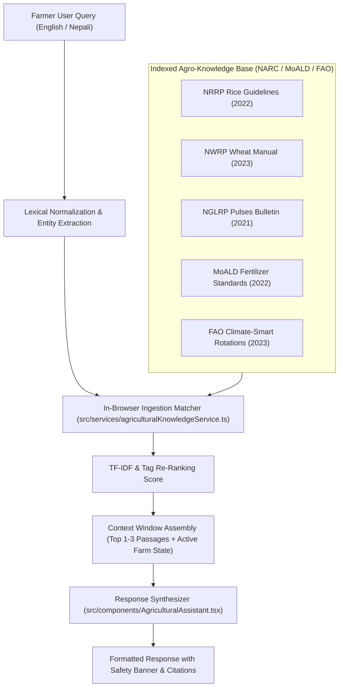

# FarmShift Nepal — Agricultural AI Assistant & RAG Architecture

**System Name:** FarmShift Nepal  
**Repository:** [https://github.com/Spongly/FarmShift](https://github.com/Spongly/FarmShift)  
**Challenge:** NASA Space Apps Challenge 2026 — *Field Shift: Adapting Farms with NASA Data*  
**Date of Audit & Specification:** October 2026  
**Implementation Standard:** Code-Truth Verified Architecture (Verified against `src/components/AgriculturalAssistant.tsx` and `src/services/agriculturalKnowledgeService.ts`)

---

## 1. Architectural Philosophy: Evidence-Grounded Zero-Hallucination AI

Agricultural advice directly impacts rural food security, chemical input expenditures, and crop survival. An AI assistant in this domain must never invent synthetic pesticide dosages, hallucinate sowing dates, or make unverified agronomic assertions.

FarmShift Nepal implements an **in-browser, client-side Retrieval-Augmented Generation (RAG) assistant**.

### Core Operational Principles
1. **Evidence-Bounded Generation:** The assistant is restricted to answering questions strictly using retrieved research passages published by the Nepal Agricultural Research Council (NARC), the Ministry of Agriculture and Livestock Development (MoALD), and international research institutes (CIMMYT, IRRI, FAO).
2. **Deterministic Fallback on Insufficient Context:** If a query falls outside the indexed agricultural literature, the system explicitly states that verified guidance is unavailable and advises consultation with the local municipal agricultural officer (कृषि ज्ञान केन्द्र / Agriculture Knowledge Centre).
3. **Mandatory Citations:** Every assertion in the assistant's response is tagged with the exact title, publishing institution, and release year of the originating document.
4. **Safety Isolation:** Agronomic warnings (e.g., toxic fertilizer combinations, delayed transplanting risks) are elevated to high-visibility safety notices.

---

## 2. In-Browser Retrieval Pipeline (TF-IDF & Metadata Search)

---

## 3. Entity Extraction & Query Tokenization

When a query is entered, the retrieval engine extracts domain entities:

### 3.1. Crop Entity Matching
The engine inspects query tokens against known crop synonyms in both English and Nepali:
- `rice`, `paddy`, `धान` $\implies$ `rice-transplanted`, `rice-direct-seeded`
- `wheat`, `गहुँ` $\implies$ `wheat`
- `maize`, `corn`, `मकै` $\implies$ `maize`
- `lentil`, `मसुरो` $\implies$ `lentil`
- `potato`, `आलु` $\implies$ `potato`
- `mustard`, `तोरि` $\implies$ `mustard`

### 3.2. Topic Entity Matching
Tokens are categorized into agricultural domains:
- `fertilizer`, `urea`, `dap`, `potash`, `मल`, `युरिया` $\implies$ `fertilizer`
- `soil`, `ph`, `acid`, `चुन`, `माटो` $\implies$ `soil`
- `water`, `irrigation`, `rain`, `सिंचाइ`, `पानी` $\implies$ `water`
- `disease`, `pest`, `बिमारी`, `रोग`, `किरा` $\implies$ `disease`
- `sowing`, `planting`, `रोप्ने`, `छर्ने` $\implies$ `planting`

---

## 4. Scoring & Passage Ranking Algorithm

In [`src/services/agriculturalKnowledgeService.ts`](file:///c:/Users/DELL/Documents/GitHub/FarmShift/src/services/agriculturalKnowledgeService.ts#L170-L215), candidate passages $p \in \mathcal{P}$ are scored according to:

$$\text{Score}(p, q) = S_{\text{crop}}(p, q) + S_{\text{topic}}(p, q) + S_{\text{lexical}}(p, q)$$

Where:
- **Crop Relevance Boost:**
  $$S_{\text{crop}}(p, q) = \begin{cases} 4.0 & \text{if } \text{CropTags}(p) \cap \text{DetectedCrops}(q) \ne \emptyset \\ 0 & \text{otherwise} \end{cases}$$
- **Topic Relevance Boost:**
  $$S_{\text{topic}}(p, q) = \begin{cases} 3.0 & \text{if } \text{TopicTags}(p) \cap \text{DetectedTopics}(q) \ne \emptyset \\ 0 & \text{otherwise} \end{cases}$$
- **Lexical Overlap Score:**
  $$S_{\text{lexical}}(p, q) = \sum_{t \in \text{Tokens}(q)} \mathbf{1}_{t \in \text{Content}(p)}$$

Passages exceeding a threshold $\tau \ge 2.0$ are sorted in descending order, with the top 3 passages loaded into the active grounding prompt.

---

## 5. Synthesis Prompt Structure & Guardrails

The response generation module combines:
1. **User Query & Selected Language (English / Nepali)**
2. **Current Farm Context:** Location name, elevation, soil pH, selected crop, upcoming 7-day rainfall.
3. **Retrieved Passages:** Full text of matched passages with publisher metadata.

### Synthesis System Rules (Enforced in Code):
- **Rule 1 (No Speculation):** Do not generate advice that contradicts or extends beyond the provided literature passages.
- **Rule 2 (Safety Priority):** If the retrieved passage contains a `safetyCaution`, prepend it immediately to the user answer.
- **Rule 3 (Local Unit Coherence):** Express land areas in Ropani or Bigha alongside Hectares; express fertilizer quantities in kilograms of commercial formulations (DAP, Urea, MOP).
- **Rule 4 (Bilingual Integrity):** Render Nepali responses in natural Devanagari script; do not output transliterated Romanized Nepali.

---

## 6. Official Grounding Sources Repository

The FarmShift knowledge registry contains indexed entries from the following government and research publications:

1. **National Rice Research Program (NRRP) / NARC (2022):**  
   *Rice Production Technology and Variety Release Guide (धान उत्पादन प्रविधि तथा जात सिफारिस निर्देशिका)*. Hardinath, Dhanusha.
2. **National Wheat Research Program (NWRP) / NARC (2023):**  
   *Wheat Agronomy & Nutrient Management Manual (गहुँ बालीको उत्पादन प्रविधि तथा मलखाद व्यवस्थापन)*. Bhairahawa, Rupandehi.
3. **National Grain Legumes Research Program (NGLRP) / NARC (2021):**  
   *Grain Legumes (Lentil, Chickpea & Soybean) Cultivation Bulletin (दलहन बाली खेती प्रविधि)*. Rampur, Chitwan.
4. **Ministry of Agriculture and Livestock Development (MoALD) (2022):**  
   *National Fertilizer Recommendation & Soil Test Interpretation Guideline (राष्ट्रिय मलखाद सिफारिस निर्देशिका)*. Singha Durbar, Kathmandu.
5. **Food and Agriculture Organization (FAO) & CIMMYT Nepal (2023):**  
   *Climate-Smart Crop Rotations in the Eastern Gangetic Plains*. Kathmandu.
