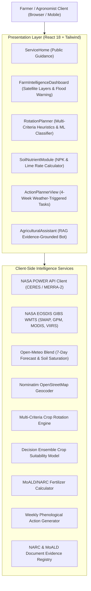

# FarmShift Nepal — Architectural Specification

**System Name:** FarmShift Nepal  
**Repository:** https://github.com/Spongly/FarmShift  
**Domain:** Climate-Adaptive Agricultural Decision Support & Earth Observation Intelligence  
**Target Region:** Nepal (Terai, Inner Terai, Mid-Hills, High Mountain)

---

## 1. High-Level Architecture Overview

---

## 2. Data Flow & Provenance Pipelines

### A. Environmental & Satellite Ingestion
1. **User Coordinate Centroid:** Established via browser GPS, interactive Leaflet map click, or administrative district geocoding.
2. **NASA POWER Ingestion:** Fetches daily observations for `PRECTOTCORR`, `T2M`, `T2M_MAX`, `T2M_MIN`, `RH2M`, `ALLSKY_SFC_SW_DWN`, `GWETTOP`, `GWETROOT`, and `TS`.
3. **Data Normalization:** Fill-values (`-999.0`) are parsed to `null` to ensure calculations do not interpret missing readings as zero rainfall or freezing temperatures.
4. **NASA GIBS WMTS Overlays:** Raster tile streams from EOSDIS GIBS (EPSG:3857) render direct satellite surface moisture, radar precipitation, and thermal heat fields.

### B. Decision Support Pipelines
1. **Crop Rotation Multi-Criteria Scoring:** Evaluates crop water footprints, thermal growth windows, biological pest/disease cycle breaks, and legume nitrogen credits.
2. **Machine Learning Model (`cropMlModel.ts`):** Evaluates multi-dimensional environmental features (elevation, temperature envelopes, effective rainfall, soil pH) against empirical decision trees to output probability confidence.
3. **Soil & Fertilizer Guidance (`soilNutrientService.ts`):** Converts farm size in Ropani, Bigha, or Hectares into precise DAP, Urea, Potash, Compost, and agricultural lime recommendations using official Nepal Government Ministry of Agriculture and Livestock Development (MoALD) equations.
4. **Actionable Task Calendar (`farmActionPlanner.ts`):** Links 7-day numerical precipitation forecasts with crop growth stages to schedule drainage excavation, sowing, weeding, and fertilizer split applications.
5. **Agricultural RAG Assistant (`agriculturalKnowledgeService.ts`):** Indexes and searches authentic Nepal Agricultural Research Council (NARC) bulletins, retrieving verified passages and providing direct citations.

---

## 3. Security, Privacy & Reliability Guarantees

- **Zero API Key Leakage:** All public APIs (NASA POWER, NASA GIBS, OpenStreetMap Nominatim, Open-Meteo) function with zero private keys, preventing credential exposure in client builds.
- **Client-Side Execution:** Calculations run entirely in the user's browser, allowing fast execution without transmitting sensitive farm boundaries to third-party tracking servers.
- **Graceful Offline Fallbacks:** Network disconnects trigger clear error alerts and cached normal fallbacks rather than fabricating false readings.
