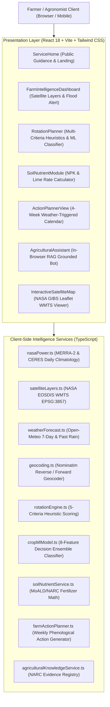
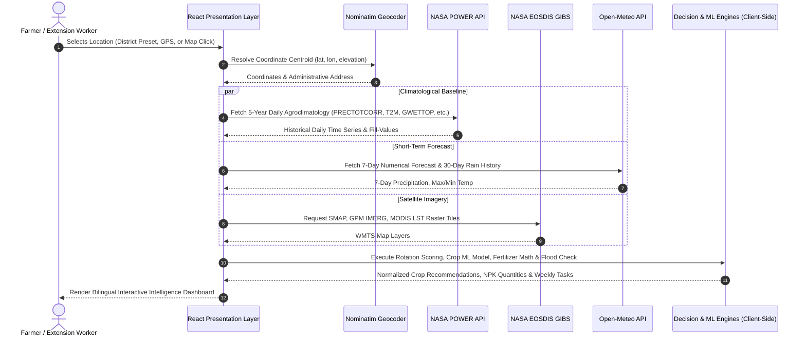

# FarmShift Nepal — Architectural Specification & Component Topology

**System Name:** FarmShift Nepal  
**Repository:** [https://github.com/Spongly/FarmShift](https://github.com/Spongly/FarmShift)  
**Domain:** Climate-Adaptive Agricultural Decision Support & Earth Observation Intelligence  
**Target Region:** Nepal (Terai, Inner Terai, Mid-Hills, High Mountain)  
**Implementation Standard:** Code-Truth Verified Architecture

---

## 1. High-Level System Architecture

---

## 2. End-to-End Data Flow

---

## 3. Component & Service Responsibility Matrix

| Subsystem / File | Architectural Role | Core Inputs | Generated Outputs | Key Dependencies |
| :--- | :--- | :--- | :--- | :--- |
| [`src/services/nasaPower.ts`](file:///c:/Users/DELL/Documents/GitHub/FarmShift/src/services/nasaPower.ts) | Historical agroclimatological ingestion | Latitude, Longitude, 5-Year Date Range | `ClimateDataset`, `MonthlyAggregate[]`, `ClimateSummary` | NASA POWER AG REST API |
| [`src/services/weatherForecast.ts`](file:///c:/Users/DELL/Documents/GitHub/FarmShift/src/services/weatherForecast.ts) | Operational short-term weather forecasting | Latitude, Longitude | 7-day daily forecast, `totalRainNext7Days`, `past30DaysRain` | Open-Meteo Public API |
| [`src/services/satelliteLayers.ts`](file:///c:/Users/DELL/Documents/GitHub/FarmShift/src/services/satelliteLayers.ts) | Earth Observation tile stream config | Selected Layer ID, Date string | Leaflet TileLayer URL template (`EPSG:3857`) | NASA EOSDIS GIBS WMTS |
| [`src/services/rotationEngine.ts`](file:///c:/Users/DELL/Documents/GitHub/FarmShift/src/services/rotationEngine.ts) | Multi-criteria crop rotation scoring | `FarmInputs`, `ClimateDataset`, `PriorityMode` | `RotationAnalysisResult`, ranked crop candidates, risk alerts | `cropData.ts`, `nasaPower.ts` |
| [`src/services/cropMlModel.ts`](file:///c:/Users/DELL/Documents/GitHub/FarmShift/src/services/cropMlModel.ts) | Non-linear crop suitability classification | `MlFeatureVector` (8 agroecological features) | `MlSuitabilityPrediction` (probability, class, feature impacts) | ECOCROP/NARC thresholds |
| [`src/services/soilNutrientService.ts`](file:///c:/Users/DELL/Documents/GitHub/FarmShift/src/services/soilNutrientService.ts) | Stoichiometric fertilizer dosage generator | `SoilTestInput` (pH, organic matter, area, unit) | `FertilizerRecommendation` (Urea, DAP, MOP, Lime kg, split schedule) | MoALD Guidelines (2022) |
| [`src/services/farmActionPlanner.ts`](file:///c:/Users/DELL/Documents/GitHub/FarmShift/src/services/farmActionPlanner.ts) | 4-week task calendar generator | `CropId`, `SoilInfo`, `WeatherForecastData` | `WeeklyFarmPlan` (drainage, sowing, weeding, top-dressing tasks) | Weather forecast blend |
| [`src/services/agriculturalKnowledgeService.ts`](file:///c:/Users/DELL/Documents/GitHub/FarmShift/src/services/agriculturalKnowledgeService.ts) | RAG document passage retrieval & search | Search query, crop tags, topic tags | `DocumentPassage[]` with official citations | NARC/MoALD document registry |
| [`src/components/AgriculturalAssistant.tsx`](file:///c:/Users/DELL/Documents/GitHub/FarmShift/src/components/AgriculturalAssistant.tsx) | Evidence-grounded bilingual chatbot | User text questions, farm context | Grounded answer with warnings and citations | `agriculturalKnowledgeService.ts` |

---

## 4. Security & Deployment Architecture

- **Zero-Secret Client Distribution:** The frontend bundle contains zero sensitive tokens, credentials, or private API keys.
- **Client-Side Privacy:** All farm parameters, land dimensions, and agronomic inputs remain within client memory (React state and browser memory).
- **Fast Static Hosting:** Bundled into optimized HTML/JS/CSS via Vite 6.0 and deployable to Cloudflare Pages, Vercel, Netlify, or standard Nginx servers with global CDN edge caching.
