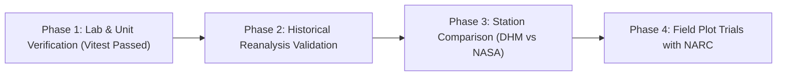

# FarmShift Nepal — System Limitations, Assumptions & Validation Roadmap

**System Name:** FarmShift Nepal  
**Repository:** [https://github.com/Spongly/FarmShift](https://github.com/Spongly/FarmShift)  
**Challenge:** NASA Space Apps Challenge 2026 — *Field Shift: Adapting Farms with NASA Data*  
**Date of Audit & Specification:** October 2026  
**Status:** Academic & Engineering Disclosure Standard

---

## 1. Executive Disclosure

FarmShift Nepal provides climate-adaptive agricultural decision support based on gridded satellite products, numerical weather forecasts, and published agronomic guidelines.

**Critical Advisory:**  
FarmShift is a decision-support advisory tool, not an automated farm control system or official regulatory instrument. It is designed to empower smallholder farmers and extension workers with data-informed insights. It does not replace on-site physical soil tests conducted in certified wet chemistry laboratories, nor does it override real-time local flood evacuation orders issued by the Department of Hydrology and Meteorology (DHM) of Nepal.

---

## 2. Spatial & Resolution Limitations

### 2.1. Satellite Gridded Data vs. Micro-Topography
- **NASA POWER Grid Resolution:** Atmospheric and surface parameters (`T2M`, `PRECTOTCORR`, `GWETTOP`) are derived at approximately $0.5^\circ \times 0.5^\circ$ ($\approx 50\text{ km} \times 50\text{ km}$) resolution.
- **Topographic Complexity in Nepal:** In Nepal, elevation can change from $200\text{ m}$ (Terai valley floor) to over $2,500\text{ m}$ (high ridges) within a horizontal distance of only $15\text{ km}$.
- **Implication:** A single $50\text{ km}$ grid cell may average across deep river valleys and high ridges. While the system allows users to specify their exact farm elevation, gridded precipitation amounts cannot fully capture valley-scale rain-shadow effects or localized orographic cloudbursts.

### 2.2. NASA GIBS Satellite Sensor Footprints
- **SMAP Soil Moisture:** Surface soil moisture layers operate at an effective spatial resolution of $9\text{ km}$. While effective for broad regional drought and soil saturation monitoring across an entire district (e.g., Chitwan or Jhapa), SMAP does not resolve field-to-field variations caused by individual drainage ditches or bund walls.
- **MODIS LST:** Operates at $1\text{ km}$ spatial resolution; overcast cloud cover during the peak monsoon (June–August) creates periodic observation dropouts in thermal optical bands.

---

## 3. Soil & Agronomic Assumptions

### 3.1. Gridded Moisture vs. In-Situ Soil Sensors
- The surface wetness fraction ($\text{GWETTOP}$, $0.0 - 1.0$) reflects the top $0–5\text{ cm}$ layer modeled by MERRA-2.
- While highly correlated with macro-scale saturation, soil water holding capacity varies significantly between sand, loam, and compacted clay. Users should input their actual soil texture in the farm profile to refine moisture interpretations.

### 3.2. Uniformity of Soil Chemical Properties
- Soil chemical recommendations (NPK and lime) assume a representative, well-mixed composite sample across the specified plot.
- Fields with extreme internal slope gradients or recent heavy erosion will experience localized leaching that requires targeted visual inspection.

---

## 4. Agricultural Safety Guardrails Implemented in Code

To prevent crop failure or chemical volatilization, the software enforces four mandatory agronomic safety boundaries:

1. **Lime & Nitrogen Fertilizer Separation:**
   - **Agronomic Fact:** Applying agricultural lime ($\text{CaCO}_3$ or $\text{CaO}$) simultaneously with Urea or DAP induces an alkaline soil surface reaction that rapidly converts ammonium ($\text{NH}_4^+$) into ammonia gas ($\text{NH}_3\uparrow$), leading to total nitrogen loss and crop seedling injury.
   - **Enforced Guardrail:** The system enforces a mandatory **3-week temporal delay** between lime incorporation and seed sowing / basal fertilizer application.
2. **Pre-Storm Flood Runoff Alerts:**
   - When topsoil saturation fraction exceeds $0.70$ and forecasted 7-day rainfall exceeds $30\text{ mm}$, the application issues a critical drainage alert, suppressing top-dressing fertilizer tasks to prevent toxic nutrient runoff into waterways.
3. **Frost & Extreme Heat Warnings:**
   - Minimum temperatures $< 2^\circ\text{C}$ trigger chilling/frost warnings for sensitive vegetable crops; maximum temperatures $> 35^\circ\text{C}$ trigger floral heat-sterility alerts.
4. **Legume Nitrogen Crediting:**
   - Automatically deducts $25\text{ kg N/ha}$ when following a legume, preventing excessive vegetative lodging and wasted chemical purchase costs.

---

## 5. Empirical Validation Roadmap

To transition FarmShift from an academic prototype and hackathon project to a field-certified national extension tool, the following four-phase validation roadmap is planned:

### Phase 1: Unit & Algorithmic Verification (Completed)
- 16 automated Vitest tests verifying stoichiometric conversions, crop ML response curves, flood trigger thresholds, and unit scaling across Ropani, Bigha, and Hectares.

### Phase 2: Historical Reanalysis Validation (Ongoing)
- Backtesting the crop suitability ensemble against 10 years of historical crop yield records published by the Nepal Ministry of Agriculture and Livestock Development (MoALD) across all 77 districts.

### Phase 3: Station Ground-Truthing (Planned)
- Comparing NASA POWER daily precipitation and temperature against ground automatic weather stations (AWS) operated by the Department of Hydrology and Meteorology (DHM) in Kathmandu, Pokhara, Rampur, and Biratnagar to determine regional bias correction coefficients.

### Phase 4: Participatory Field Demonstration (Planned)
- Partnering with local agricultural cooperatives and Agricultural Knowledge Centres (AKCs) in Province 1 (Koshi) and Bagmati to test usability, farmer comprehension of bilingual advisories, and net fertilizer savings.
